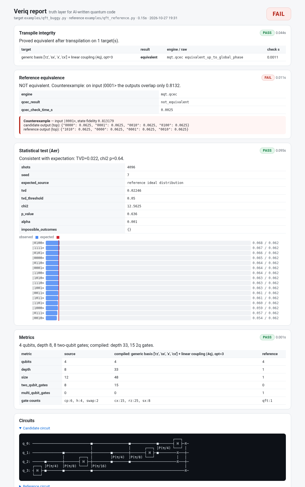

# Veriq — a truth layer for AI-written quantum code

LLMs now write a lot of quantum code. Some of it is wrong in ways that are hard to spot:
a swapped CNOT, an off-by-one rotation angle, an oracle that forgets to uncompute.
Running the circuit once and looking at a histogram often **does not** reveal the bug.

**Veriq** is a neutral, open verification layer. Give it a circuit (and optionally a
trusted reference or an expected result) and it returns **PASS / FAIL / INCONCLUSIVE**
for each check, with evidence, plus an overall verdict and a self-contained HTML/JSON report.

| # | Check | What it proves | Engine |
|---|-------|----------------|--------|
| 1 | **Transpile integrity** | The compiled circuit (generic `rz/sx/x/cx` basis + linear coupling, optionally a `GenericBackendV2` fake backend) still implements the source circuit. | MQT QCEC, fallback `qiskit.quantum_info.Operator` (≤10 qubits) |
| 2 | **Reference equivalence** | The candidate is formally equivalent (up to global phase) to a trusted reference. On failure, Veriq searches for a **concrete counterexample** input state and shows both outputs. | MQT QCEC + statevector search (≤12 qubits) |
| 3 | **Statistical test** | Shots on Qiskit Aer match an expected distribution (or the reference's ideal distribution, or an allowed support set). Chi-square goodness-of-fit + total variation distance, plus "impossible outcome" detection. | Qiskit Aer, SciPy |
| 4 | **Metrics** | Qubits, depth, size, gate counts, 2-qubit and 3+-qubit gate counts, before vs after transpilation. | Qiskit |

Overall verdict: **FAIL** if any check fails, **PASS** if every applicable check passes,
otherwise **INCONCLUSIVE**. Checks that do not apply (e.g. no `--reference`) are `SKIPPED`.
CLI exit codes: `0` PASS, `1` FAIL, `2` INCONCLUSIVE, `3` input error — so it drops straight into CI.

## Install

Python 3.10+ (developed on 3.13).

```bash
python3 -m venv .venv
.venv/bin/pip install -e '.[dev]'      # or: make install
```

Pinned stack: `qiskit 2.6.1`, `qiskit-aer 0.18.2`, `mqt.qcec 3.11.0`, `qiskit-qasm3-import`, `scipy`.

## Usage

```bash
veriq check <candidate.py | .qasm | .qasm3> \
    [--reference <trusted.py | .qasm>] \
    [--expect '<json>' | --expect expected.json] \
    [--backend generic | generic:<nqubits>] \
    [--shots 4096] [--seed 7] [--timeout 30] \
    --report out.html [--json out.json]
```

**Loading circuits**
- `.py`: the module must expose a `QuantumCircuit` named `circuit`, or a `build()` function returning one.
- `.qasm` / `.qasm3`: OpenQASM 2 or 3 (detected from the `OPENQASM` header).
- Final measurements are stripped for the formal checks and re-added (`measure_all`) for sampling.

**`--expect` formats** (inline JSON or a file; bitstrings in Qiskit order, qubit 0 rightmost)
```jsonc
{"000": 0.5, "111": 0.5}                                  // bare distribution
{"distribution": {"00": 0.5, "11": 0.5}, "shots": 8192, "tvd_threshold": 0.05}
{"support": ["000", "111"]}                               // property: only these outcomes may appear
```
Without `--expect` but with `--reference`, the reference's ideal distribution is used.

**Example**
```bash
veriq check examples/qft_buggy.py --reference examples/qft_reference.py --report reports/qft_buggy.html
```
```
Veriq  examples/qft_buggy.py  vs  examples/qft_reference.py
  ✔ PASS         Transpile integrity      Proved equivalent after transpilation on 1 target(s).
  ✘ FAIL         Reference equivalence    NOT equivalent. Counterexample: on input |0001> the outputs overlap only 0.8132.
  ✔ PASS         Statistical test (Aer)   Consistent with expectation: TVD=0.022, chi2 p=0.64.
  ✔ PASS         Metrics                  4 qubits, depth 8, 8 two-qubit gates; compiled: depth 33, 15 2q gates.
  => VERDICT: FAIL
```
Note how the histogram test alone would have *passed* this buggy QFT — that is the point of Veriq.



## Demo and tests

```bash
./scripts/demo.sh        # or: make demo   — runs every example, writes reports/*.html + *.json
.venv/bin/python -m pytest -q             # or: make test
```

| Example | Should be | What is wrong |
|---------|-----------|---------------|
| `bell_correct.py`, `bell.qasm` | PASS | — |
| `ghz_correct.py`, `ghz3.qasm3` | PASS | — |
| `ghz_buggy.py` | FAIL | last CNOT has control/target swapped |
| `qft_correct.py` vs `qft_reference.py` | PASS | — (hand-written vs library `QFTGate`) |
| `qft_buggy.py` vs `qft_reference.py` | FAIL | every controlled-phase angle halved (off-by-one exponent) |
| `grover_correct.py` (3q, marks `101`) | PASS | — |
| `grover_buggy.py` | FAIL | oracle forgets to uncompute an `X` |

`demo.sh` exits non-zero if any example gets the wrong verdict.

## Week 2: modes, gate-set constraints, LLM benchmark

New options for `veriq check`:
- `--function NAME` / `--reference-function NAME`: pick a builder inside a multi-function `.py` file.
- `--mode state`: compare the states prepared from |0...0> (fidelity, up to global phase) instead of
  full unitaries — the right check when the spec is a state (GHZ, W, Grover output).
- `--allowed-gates h,t,tdg,cx`: gate-set constraint; any other instruction is a **FAIL**.
- Candidate code that raises or returns no circuit is a **FAIL** with error type `does not build`
  (a missing file is still an input error, exit 3).

`benchmark/` holds 28 circuits written by ChatGPT, Claude, Gemini and Perplexity (verbatim in
`benchmark/llm/raw/`), independently verified references (`benchmark/references.py`), and the harness:

```bash
.venv/bin/python benchmark/run_llm.py   # -> benchmark/results/{results.json,results.md,reports/*.html}
```

## Hard round: 7 non-standard tasks, proof-only bugs

New options for `veriq check`:
- `--coupling linear|ring|0-1,1-2,...`: coupling-map constraint checked on the circuit **as written**
  (before any transpilation, so a router cannot "fix" it). Any 2-qubit gate off an edge, or any gate on
  3+ qubits, is a **FAIL**. A malformed edge or a qubit index out of range is an input error (exit 3).
- `--no-black-boxes`: **FAIL** on `UnitaryGate`, `initialize`, `StatePreparation`, `PermutationGate`,
  `QFTGate`, isometries and other library blocks, so the circuit must be built from elementary gates
  (`mcx`/`mcp` are allowed).
- Exit codes are unchanged: 0 PASS, 1 FAIL, 2 INCONCLUSIVE, 3 input error.
- **Transpile integrity now uses `qubits_initially_zero=False` in unitary mode.** Qiskit's default
  `transpile()` assumes all qubits start in |0> and may borrow idle qubits as clean ancillas when it
  synthesises an `mcx`. The output is then right from |0...0> but wrong as a unitary (e.g. `mcx([0,3,4],5)`
  on 6 qubits). Veriq proves the safe compile and reports the default-compile hazard as information
  (`zero_init_hazard` in the evidence). State mode keeps the default.

`benchmark/hard/` holds the 7-task prompt (`prompt.md`, reconstructed), the four assistants' answers
verbatim (`raw/*.py`, never edited), references proven against exhaustive truth tables
(`references.py`), and the harness:

```bash
.venv/bin/python benchmark/hard/run_hard.py              # ~2 min incl. mutation study
.venv/bin/python benchmark/hard/run_hard.py --no-mutants # ~10 s, verdicts and costs only
# -> benchmark/hard/results/{results.json,results.md,mutation.json,reports/*.html}
```

Findings (details in `benchmark/hard/results/results.md`):
- All 28 circuits are correct (28/28 PASS, proved). Gemini's C3X uses `rz` instead of `p` and differs by
  the global phase e^{-iπ/16}, which is allowed.
- The costs are very different: after transpiling to {cx, rz, sx, x}, cmul7 ranges from 70 to 1116 CX
  (15.9x), maj5 from 240 to 1312 (5.5x), and C3X on a linear chain from 24 to 150 (6.2x).
- In 5 of 28 circuits, Qiskit's default compile is not unitary-equivalent (the `qubits_initially_zero`
  hazard). Only a unitary proof sees this.
- Mutation study: 1036 injected bugs (deleted gate, negated angle, π written as 3.14, flipped CX,
  cp→crz, p→rz) were added to the 28 correct circuits. Of 966 truly wrong mutants, the usual Aer
  histogram from |0...0> catches only 327 (34%). 596 more need an exhaustive basis-input sweep. 43 are
  caught by the proof alone:
  - 39 phase errors in the C3X circuits leave every basis-input distribution unchanged, so no sampling
    test can catch them;
  - in 4 QPE circuits, π written as 3.14 moves the output distribution by a TVD of about 1e-6, far below
    shot noise.

## Showcase: the silent transpile footgun

`examples/transpile_hazard/` contains a 5-qubit `mcx([0,1,2], 3)` block. After a default
`transpile()` it passes Aer sampling (TVD 0), yet Veriq proves it NOT equivalent, with
counterexample |10100>. Reused via `to_gate()`, it gives the wrong output.

This is documented Qiskit behaviour (`qubits_initially_zero=True` since 1.3), not a Qiskit
bug. The fix is `qubits_initially_zero=False`. See that folder's README. Post drafts are in
`docs/posts/transpile_hazard_{en,he}.md`.

```
python examples/transpile_hazard/demo.py
```

## Project layout

```
src/veriq/   loader.py  checks.py  runner.py  report.py  cli.py  models.py
examples/    correct and buggy circuits + expect/*.json
tests/       pytest suite (unit + end-to-end through the CLI)
scripts/     demo.sh
```

## Limitations (week 1)

- Formal checks cover the **unitary part** only; mid-circuit measurement, reset and classical control flow give `INCONCLUSIVE`.
- Counterexample search is exhaustive over basis states (plus `|+…+>`) only up to 12 qubits; the Operator fallback is capped at 10 qubits.
- The statistical test uses a noiseless simulator; noise-aware thresholds come later.
- Fake-backend support is `GenericBackendV2` only (no vendor calibration snapshots yet).
- Qiskit is the only front-end today (OpenQASM 2/3 as interchange).

## Roadmap

- **Week 1 (this release):** CLI, four checks, HTML/JSON report, examples, tests.
- **Week 2 — benchmark:** collect ~20 circuits written by different LLMs (ChatGPT, Claude, Gemini, …) for standard tasks, run Veriq on all of them, and publish the bug-catch rate — the first evidence that the tool is needed.
- **Week 3 — QML claim audit:** check "quantum advantage" claims of quantum-ML notebooks against strong classical baselines on the same data, with fair hyper-parameter budgets and statistical significance.
- **Week 4 — CI integration:** a GitHub Action that runs `veriq check` on pull requests and posts the report, plus a `pytest` plugin (`assert_equivalent`, `assert_distribution`) for quantum test suites.

## License

Apache-2.0
