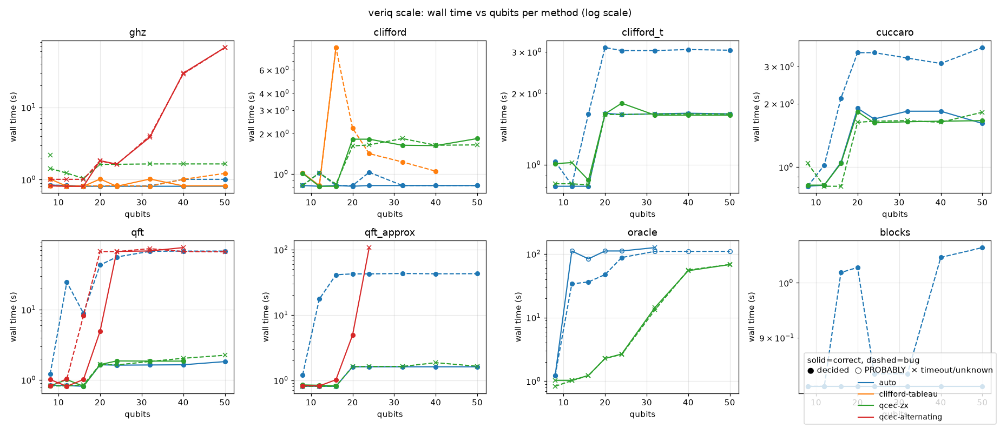

# Scaling benchmark

Generated from `results.json` (299 runs, data written 2026-10-27 23:09:46 +0200). 8 CPUs, 3 cases in parallel, each in a fresh process hard-killed at 120s (auto) / 75s (single-method sweeps). Memory is peak RSS of the case process tree (≈135 MB is the Python + Qiskit baseline).

**Legend.** `PROVEN` = equivalence proven (Clifford tableau, QCEC, exact MPS state overlap). `NOT` = non-equivalence decided (proof or concrete witness). `PROBABLY*` = **falsification only**: no difference found on the simulated inputs; veriq reports this as INCONCLUSIVE and never as a proof. `unknown` = method not applicable / gave up. `timeout` = killed at the cap. `not run` = cell not reached (series stopped or session cut short). `†` = measured with the earlier engine revision 6b1420b (oracle correct n≥12; the rerun was interrupted).

## Auto pipeline (what `verify`/`compare` use)

### correct version

| family | n=8 | n=12 | n=16 | n=20 | n=24 | n=32 | n=40 | n=50 | n=100 | n=200 |
|---|---|---|---|---|---|---|---|---|---|---|
| ghz | PROVEN · clifford-tableau · 0.0s · 137MB | PROVEN · clifford-tableau · 0.0s · 139MB | PROVEN · clifford-tableau · 0.0s · 138MB | PROVEN · clifford-tableau · 0.0s · 139MB | PROVEN · clifford-tableau · 0.0s · 138MB | PROVEN · clifford-tableau · 0.0s · 139MB | PROVEN · clifford-tableau · 0.0s · 139MB | PROVEN · clifford-tableau · 0.0s · 138MB | PROVEN · clifford-tableau · 0.1s · 139MB | PROVEN · clifford-tableau · 0.3s · 141MB |
| clifford | PROVEN · clifford-tableau · 0.0s · 139MB | PROVEN · clifford-tableau · 0.0s · 139MB | PROVEN · clifford-tableau · 0.0s · 138MB | PROVEN · clifford-tableau · 0.0s · 138MB | PROVEN · clifford-tableau · 0.0s · 139MB | PROVEN · clifford-tableau · 0.0s · 134MB | PROVEN · clifford-tableau · 0.0s · 134MB | PROVEN · clifford-tableau · 0.0s · 133MB | PROVEN · clifford-tableau · 0.0s · 142MB | PROVEN · clifford-tableau · 0.1s · 151MB |
| clifford_t | PROVEN · operator · 0.0s · 138MB | PROVEN · alternating · 0.0s · 138MB | PROVEN · zx · 0.0s · 138MB | PROVEN · zx · 0.7s · 292MB | PROVEN · zx · 0.7s · 292MB | PROVEN · zx · 0.8s · 291MB | PROVEN · zx · 0.8s · 289MB | PROVEN · zx · 0.7s · 297MB | n/a | n/a |
| cuccaro | PROVEN · operator · 0.0s · 135MB | PROVEN · zx · 0.0s · 133MB | PROVEN · zx · 0.0s · 144MB | PROVEN · zx · 0.9s · 282MB | PROVEN · zx · 0.8s · 282MB | PROVEN · zx · 0.9s · 282MB | PROVEN · zx · 0.9s · 283MB | PROVEN · zx · 0.9s · 284MB | n/a | n/a |
| qft | PROVEN · operator · 0.1s · 137MB | PROVEN · zx · 0.0s · 144MB | PROVEN · zx · 0.0s · 138MB | PROVEN · zx · 0.8s · 278MB | PROVEN · zx · 0.8s · 277MB | PROVEN · zx · 0.8s · 292MB | PROVEN · zx · 0.9s · 297MB | PROVEN · zx · 1.0s · 308MB | n/a | n/a |
| qft_approx | PROVEN · operator · 0.1s · 138MB | PROVEN · zx · 0.0s · 138MB | PROVEN · zx · 0.0s · 138MB | PROVEN · zx · 0.8s · 276MB | PROVEN · zx · 0.8s · 275MB | PROVEN · zx · 0.8s · 278MB | PROVEN · zx · 0.8s · 278MB | PROVEN · zx · 0.8s · 277MB | n/a | n/a |
| oracle | PROVEN · operator · 0.3s · 145MB | PROBABLY* · simulation · 110.0s · 388MB † | PROBABLY* · simulation · 82.7s · 414MB † | PROBABLY* · simulation · 110.1s · 564MB † | PROBABLY* · simulation · 110.0s · 570MB † | timeout · auto · 125.7s · 442MB † | not run | not run | n/a | n/a |
| blocks | PROVEN · part+operator · 0.0s · 138MB | PROVEN · part+operator · 0.0s · 138MB | PROVEN · part+clifford-tableau+operator · 0.0s · 139MB | PROVEN · part+operator · 0.0s · 132MB | PROVEN · part+operator · 0.0s · 138MB | PROVEN · part+operator · 0.0s · 138MB | PROVEN · part+operator · 0.0s · 137MB | PROVEN · part+operator · 0.0s · 138MB | n/a | n/a |

### bug version

| family | n=8 | n=12 | n=16 | n=20 | n=24 | n=32 | n=40 | n=50 | n=100 | n=200 |
|---|---|---|---|---|---|---|---|---|---|---|
| ghz | NOT · clifford-tableau · 0.0s · 134MB | NOT · clifford-tableau · 0.0s · 139MB | NOT · clifford-tableau · 0.0s · 138MB | NOT · clifford-tableau · 0.0s · 139MB | NOT · clifford-tableau · 0.0s · 139MB | NOT · clifford-tableau · 0.1s · 139MB | NOT · clifford-tableau · 0.1s · 139MB | NOT · clifford-tableau · 0.3s · 139MB | NOT · clifford-tableau · 1.9s · 140MB | NOT · clifford-tableau · 15.2s · 142MB |
| clifford | NOT · clifford-tableau · 0.0s · 134MB | NOT · clifford-tableau · 0.0s · 139MB | NOT · clifford-tableau · 0.0s · 135MB | NOT · clifford-tableau · 0.0s · 135MB | NOT · clifford-tableau · 0.0s · 139MB | NOT · clifford-tableau · 0.0s · 133MB | NOT · clifford-tableau · 0.0s · 136MB | NOT · clifford-tableau · 0.0s · 135MB | NOT · clifford-tableau · 0.1s · 143MB | NOT · clifford-tableau · 0.6s · 153MB |
| clifford_t | NOT · operator · 0.1s · 156MB | NOT · alternating · 0.0s · 138MB | NOT · alternating · 0.8s · 310MB | NOT · alternating · 2.3s · 300MB | NOT · alternating · 2.2s · 307MB | NOT · alternating · 2.3s · 305MB | NOT · alternating · 2.3s · 309MB | NOT · alternating · 2.3s · 315MB | n/a | n/a |
| cuccaro | NOT · operator · 0.1s · 138MB | NOT · alternating · 0.1s · 147MB | NOT · alternating · 1.2s · 298MB | NOT · alternating · 2.5s · 284MB | NOT · alternating · 2.5s · 294MB | NOT · alternating · 2.5s · 298MB | NOT · alternating · 2.4s · 298MB | NOT · alternating · 2.9s · 309MB | n/a | n/a |
| qft | NOT · operator · 0.5s · 146MB | NOT · alternating · 23.8s · 161MB | NOT · alternating · 8.1s · 299MB | NOT · simulation · 42.3s · 424MB | NOT · simulation · 55.4s · 436MB | NOT · mps-falsify · 66.9s · 453MB | NOT · mps-falsify · 67.3s · 439MB | NOT · mps-falsify · 67.3s · 422MB | n/a | n/a |
| qft_approx | NOT · operator · 0.4s · 144MB | NOT · alternating · 16.5s · 169MB | NOT · alternating · 40.3s · 436MB | NOT · simulation · 41.6s · 475MB | NOT · simulation · 41.5s · 324MB | NOT · simulation · 42.1s · 342MB | NOT · simulation · 41.6s · 310MB | NOT · simulation · 41.9s · 348MB | n/a | n/a |
| oracle | NOT · operator · 0.3s · 147MB | NOT · exhaustive-basis · 33.0s · 397MB | NOT · mps-falsify · 35.3s · 409MB | NOT · mps-falsify · 46.3s · 537MB | NOT · mps-falsify · 86.6s · 555MB | PROBABLY* · simulation · 108.6s · 545MB | PROBABLY* · simulation · 108.7s · 741MB | PROBABLY* · simulation · 108.6s · 785MB | n/a | n/a |
| blocks | NOT · part+operator · 0.0s · 138MB | NOT · part+operator · 0.0s · 136MB | NOT · part+operator · 0.0s · 141MB | NOT · part+operator · 0.0s · 142MB | NOT · part+operator · 0.0s · 134MB | NOT · part+operator · 0.0s · 139MB | NOT · part+operator · 0.1s · 135MB | NOT · part+operator · 0.1s · 144MB | n/a | n/a |

### Summary: decided vs falsification-only vs inconclusive (auto)

| family | variant | decided | falsification-only | inconclusive |
|---|---|---|---|---|
| ghz | correct | 10 | 0 | 0 |
| ghz | bug | 10 | 0 | 0 |
| clifford | correct | 10 | 0 | 0 |
| clifford | bug | 10 | 0 | 0 |
| clifford_t | correct | 8 | 0 | 0 |
| clifford_t | bug | 8 | 0 | 0 |
| cuccaro | correct | 8 | 0 | 0 |
| cuccaro | bug | 8 | 0 | 0 |
| qft | correct | 8 | 0 | 0 |
| qft | bug | 8 | 0 | 0 |
| qft_approx | correct | 8 | 0 | 0 |
| qft_approx | bug | 8 | 0 | 0 |
| oracle | correct | 1 | 4 | 1 |
| oracle | bug | 5 | 3 | 0 |
| blocks | correct | 8 | 0 | 0 |
| blocks | bug | 8 | 0 | 0 |

## Single-method sweeps

Each method alone (no partitioning), same circuits. A series stops after its first timeout, so cells after a timeout read `not run`. **Not run at all (session cut short):** qcec-construction, qcec-simulation, mps-falsify.

### ghz

| method | variant | n=8 | n=12 | n=16 | n=20 | n=24 | n=32 | n=40 | n=50 | n=100 | n=200 |
|---|---|---|---|---|---|---|---|---|---|---|---|
| clifford-tableau | correct | PROVEN · clifford-tableau · 0.0s · 139MB | PROVEN · clifford-tableau · 0.0s · 132MB | PROVEN · clifford-tableau · 0.0s · 136MB | PROVEN · clifford-tableau · 0.0s · 130MB | PROVEN · clifford-tableau · 0.0s · 136MB | PROVEN · clifford-tableau · 0.0s · 130MB | PROVEN · clifford-tableau · 0.0s · 139MB | PROVEN · clifford-tableau · 0.0s · 138MB | PROVEN · clifford-tableau · 0.1s · 139MB | PROVEN · clifford-tableau · 0.3s · 141MB |
| clifford-tableau | bug | NOT · clifford-tableau · 0.0s · 138MB | NOT · clifford-tableau · 0.0s · 138MB | NOT · clifford-tableau · 0.0s · 138MB | NOT · clifford-tableau · 0.0s · 138MB | NOT · clifford-tableau · 0.0s · 138MB | NOT · clifford-tableau · 0.1s · 138MB | NOT · clifford-tableau · 0.2s · 139MB | NOT · clifford-tableau · 0.3s · 139MB | NOT · clifford-tableau · 2.0s · 140MB | timeout · clifford-tableau · 108.9s · 142MB |
| qcec-zx | correct | unknown · zx · 0.0s · 137MB | not run | not run | not run | not run | not run | not run | not run | not run | not run |
| qcec-zx | bug | unknown · zx · 0.0s · 143MB | unknown · zx · 0.0s · 142MB | unknown · zx · 0.0s · 142MB | unknown · zx · 0.8s · 272MB | unknown · zx · 0.8s · 280MB | unknown · zx · 0.8s · 280MB | unknown · zx · 0.8s · 281MB | unknown · zx · 0.8s · 281MB | not run | not run |
| qcec-alternating | correct | unknown · alternating · 0.0s · 138MB | unknown · alternating · 0.0s · 138MB | unknown · alternating · 0.0s · 133MB | unknown · alternating · 0.8s · 285MB | unknown · alternating · 0.8s · 273MB | unknown · alternating · 2.9s · 316MB | unknown · alternating · 28.9s · 491MB | unknown · alternating · 66.3s · 473MB | not run | not run |
| qcec-alternating | bug | unknown · alternating · 0.0s · 146MB | unknown · alternating · 0.0s · 146MB | unknown · alternating · 0.0s · 146MB | unknown · alternating · 0.8s · 285MB | unknown · alternating · 0.7s · 270MB | unknown · alternating · 3.2s · 317MB | unknown · alternating · 28.2s · 490MB | unknown · alternating · 66.3s · 474MB | not run | not run |

### clifford

| method | variant | n=8 | n=12 | n=16 | n=20 | n=24 | n=32 | n=40 | n=50 |
|---|---|---|---|---|---|---|---|---|---|
| clifford-tableau | correct | PROVEN · clifford-tableau · 0.0s · 139MB | PROVEN · clifford-tableau · 0.0s · 136MB | PROVEN · clifford-tableau · 0.0s · 139MB | not run | not run | not run | not run | not run |
| clifford-tableau | bug | NOT · clifford-tableau · 0.0s · 139MB | NOT · clifford-tableau · 0.0s · 138MB | NOT · clifford-tableau · 0.0s · 139MB | NOT · clifford-tableau · 0.0s · 137MB | NOT · clifford-tableau · 0.0s · 139MB | NOT · clifford-tableau · 0.0s · 139MB | NOT · clifford-tableau · 0.0s · 140MB | not run |
| qcec-zx | correct | PROVEN · zx · 0.0s · 144MB | PROVEN · zx · 0.0s · 138MB | PROVEN · zx · 0.0s · 138MB | PROVEN · zx · 0.8s · 282MB | PROVEN · zx · 0.9s · 282MB | PROVEN · zx · 0.8s · 282MB | PROVEN · zx · 0.8s · 282MB | PROVEN · zx · 0.8s · 281MB |
| qcec-zx | bug | unknown · zx · 0.0s · 134MB | unknown · zx · 0.0s · 144MB | unknown · zx · 0.0s · 133MB | unknown · zx · 0.8s · 282MB | unknown · zx · 0.8s · 282MB | unknown · zx · 0.8s · 282MB | unknown · zx · 0.8s · 283MB | unknown · zx · 0.8s · 275MB |

### clifford_t

| method | variant | n=8 | n=12 | n=16 | n=20 | n=24 | n=32 | n=40 | n=50 |
|---|---|---|---|---|---|---|---|---|---|
| qcec-zx | correct | PROVEN · zx · 0.0s · 157MB | unknown · zx · 0.0s · 157MB | PROVEN · zx · 0.0s · 138MB | PROVEN · zx · 0.8s · 285MB | PROVEN · zx · 0.8s · 295MB | PROVEN · zx · 0.7s · 286MB | PROVEN · zx · 0.8s · 300MB | PROVEN · zx · 0.7s · 304MB |
| qcec-zx | bug | unknown · zx · 0.0s · 138MB | unknown · zx · 0.0s · 138MB | unknown · zx · 0.0s · 138MB | unknown · zx · 0.7s · 291MB | unknown · zx · 0.7s · 287MB | unknown · zx · 0.8s · 288MB | unknown · zx · 0.9s · 302MB | unknown · zx · 0.8s · 302MB |

### cuccaro

| method | variant | n=8 | n=12 | n=16 | n=20 | n=24 | n=32 | n=40 | n=50 |
|---|---|---|---|---|---|---|---|---|---|
| qcec-zx | correct | PROVEN · zx · 0.0s · 136MB | PROVEN · zx · 0.0s · 138MB | PROVEN · zx · 0.0s · 144MB | PROVEN · zx · 0.8s · 282MB | PROVEN · zx · 0.8s · 283MB | PROVEN · zx · 0.8s · 282MB | PROVEN · zx · 0.8s · 276MB | PROVEN · zx · 0.8s · 285MB |
| qcec-zx | bug | unknown · zx · 0.0s · 144MB | unknown · zx · 0.0s · 135MB | unknown · zx · 0.0s · 137MB | unknown · zx · 0.8s · 283MB | unknown · zx · 0.8s · 278MB | unknown · zx · 0.8s · 283MB | unknown · zx · 0.8s · 276MB | unknown · zx · 0.8s · 285MB |

### qft

| method | variant | n=8 | n=12 | n=16 | n=20 | n=24 | n=32 | n=40 | n=50 |
|---|---|---|---|---|---|---|---|---|---|
| qcec-zx | correct | PROVEN · zx · 0.0s · 138MB | PROVEN · zx · 0.0s · 130MB | PROVEN · zx · 0.0s · 135MB | PROVEN · zx · 0.8s · 274MB | PROVEN · zx · 0.9s · 285MB | PROVEN · zx · 0.9s · 282MB | PROVEN · zx · 1.0s · 296MB | not run |
| qcec-zx | bug | unknown · zx · 0.0s · 138MB | unknown · zx · 0.0s · 135MB | unknown · zx · 0.0s · 138MB | unknown · zx · 0.8s · 271MB | unknown · zx · 0.8s · 285MB | unknown · zx · 0.9s · 291MB | unknown · zx · 1.0s · 297MB | unknown · zx · 1.3s · 307MB |
| qcec-alternating | correct | PROVEN · alternating · 0.0s · 139MB | PROVEN · alternating · 0.0s · 136MB | PROVEN · alternating · 0.2s · 147MB | PROVEN · alternating · 4.0s · 547MB | unknown · alternating · 66.4s · 3486MB | unknown · alternating · 67.2s · 3902MB | timeout · alternating · 76.5s · 1291MB | not run |
| qcec-alternating | bug | NOT · alternating · 0.0s · 136MB | NOT · alternating · 0.1s · 147MB | NOT · alternating · 7.2s · 238MB | unknown · alternating · 66.3s · 459MB | unknown · alternating · 66.2s · 437MB | unknown · alternating · 73.0s · 375MB | unknown · alternating · 66.2s · 465MB | unknown · alternating · 65.5s · 543MB |

### qft_approx

| method | variant | n=8 | n=12 | n=16 | n=20 | n=24 | n=32 | n=40 | n=50 |
|---|---|---|---|---|---|---|---|---|---|
| qcec-zx | correct | PROVEN · zx · 0.0s · 138MB | PROVEN · zx · 0.0s · 135MB | PROVEN · zx · 0.0s · 143MB | not run | not run | not run | not run | not run |
| qcec-zx | bug | unknown · zx · 0.0s · 138MB | unknown · zx · 0.0s · 138MB | unknown · zx · 0.0s · 138MB | unknown · zx · 0.8s · 282MB | unknown · zx · 0.8s · 282MB | unknown · zx · 0.8s · 270MB | unknown · zx · 1.0s · 275MB | unknown · zx · 0.8s · 284MB |
| qcec-alternating | correct | PROVEN · alternating · 0.0s · 135MB | PROVEN · alternating · 0.0s · 138MB | PROVEN · alternating · 0.1s · 147MB | PROVEN · alternating · 4.0s · 546MB | timeout · alternating · 107.2s · 2848MB | not run | not run | not run |
| qcec-alternating | bug | not run | not run | not run | not run | not run | not run | not run | not run |

### oracle

| method | variant | n=8 | n=12 | n=16 | n=20 | n=24 | n=32 | n=40 | n=50 |
|---|---|---|---|---|---|---|---|---|---|
| qcec-zx | correct | unknown · zx · 0.0s · 148MB | unknown · zx · 0.1s · 153MB | unknown · zx · 0.3s · 162MB | unknown · zx · 1.3s · 316MB | unknown · zx · 1.8s · 331MB | unknown · zx · 13.4s · 377MB | unknown · zx · 53.3s · 489MB | unknown · zx · 67.1s · 691MB |
| qcec-zx | bug | unknown · zx · 0.0s · 136MB | unknown · zx · 0.1s · 151MB | unknown · zx · 0.3s · 162MB | unknown · zx · 1.3s · 317MB | unknown · zx · 1.8s · 331MB | unknown · zx · 12.2s · 376MB | unknown · zx · 54.9s · 491MB | unknown · zx · 67.1s · 689MB |

